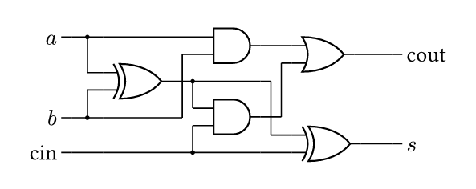
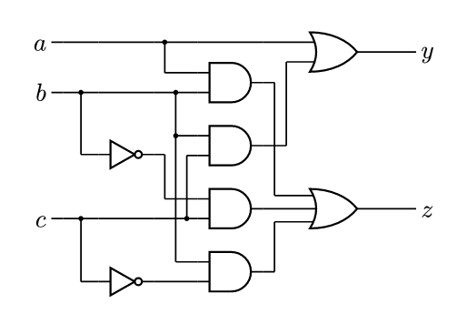
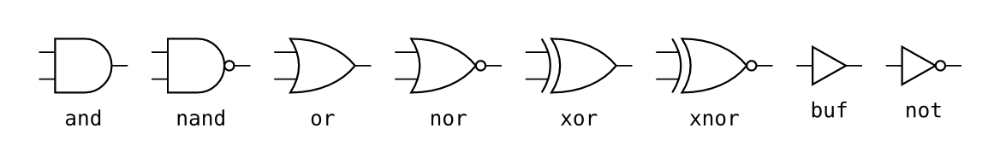

# logicz

Gate-level logic circuit diagrams for [Typst](https://typst.app), drawn with
[CeTZ](https://github.com/cetz-package/cetz). Gates use the IEEE Std 91/91a-1991
*distinctive shape* symbols.

Write the netlist, get the schematic: gates, wires, junction dots and labels
are laid out automatically, like Mermaid or D2 but for logic gates.

````typ
#import "@preview/logicz:0.1.1": logic

#logic(```
in a b cin
p    = xor(a, b)
s    = xor(p, cin)
cout = or(and(a, b), and(p, cin))
```)
````



````typ
#logic(```
in a b c
y = or(a, and(b, c))
z = or(and(a, b), and(not(b), c), and(b, not(c)))
```)
````



## Features

- `and`, `or`, `nand`, `nor`, `xor`, `xnor`, `not`, `buf`, with any number of
  inputs (IEEE-style extension lines on wide gates).
- `!x` puts an inversion bubble on an input instead of a NOT gate.
- Identical sub-expressions are shared; named signals can be reused anywhere.
- Automatic layered layout with orthogonal wiring and junction dots.
- `gate()` for placing gates by hand in any CeTZ canvas, with anchors
  `in1`..`inN` and `out`; `gate-symbol()` for gates inline in text or tables.



## Netlist syntax

| Syntax                  | Meaning                                                |
| ----------------------- | ------------------------------------------------------ |
| `y = and(a, b)`         | gate `y` with inputs `a`, `b`                          |
| `y = or(a, and(b, c))`  | nested gates                                           |
| `and(!a, b)`            | inversion bubble on input `a`                          |
| `in a b c`              | optional: input order, top to bottom                   |
| `out y z`               | optional: which signals get output labels              |
| `// ...`                | comment                                                |

Statements may span several lines while parentheses are open.

Any name that is never assigned is a primary input. Circuits with feedback
(latches, flip-flops) are rejected by the auto-layout; draw them with `gate()`.

See the [manual](docs/manual.pdf) for all options.

## Development

Requires [just](https://github.com/casey/just).

```sh
just test      # compile tests/*.typ, check tests/fail/*.typ fail as expected
just docs      # build docs/manual.pdf
just images    # render the README images
just install   # symlink as @local/logicz:<version>
```

## License

MIT
